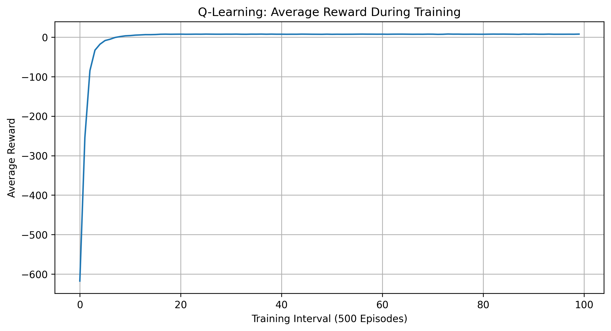
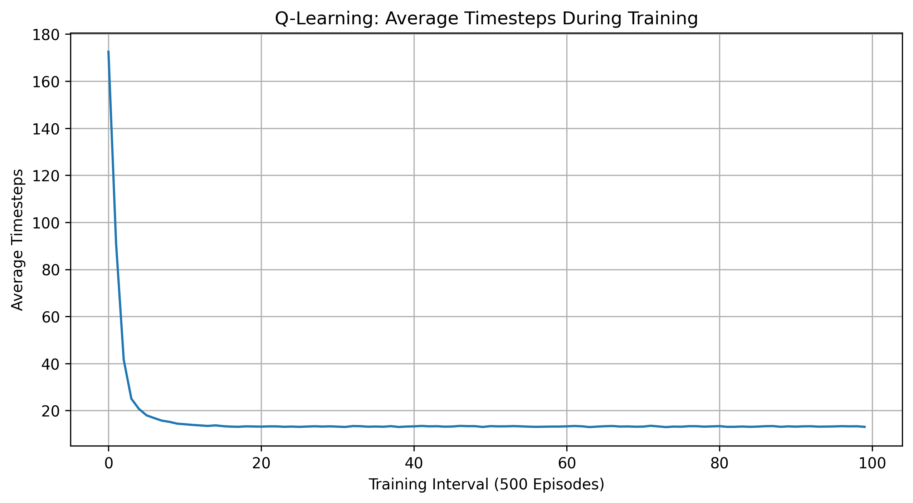
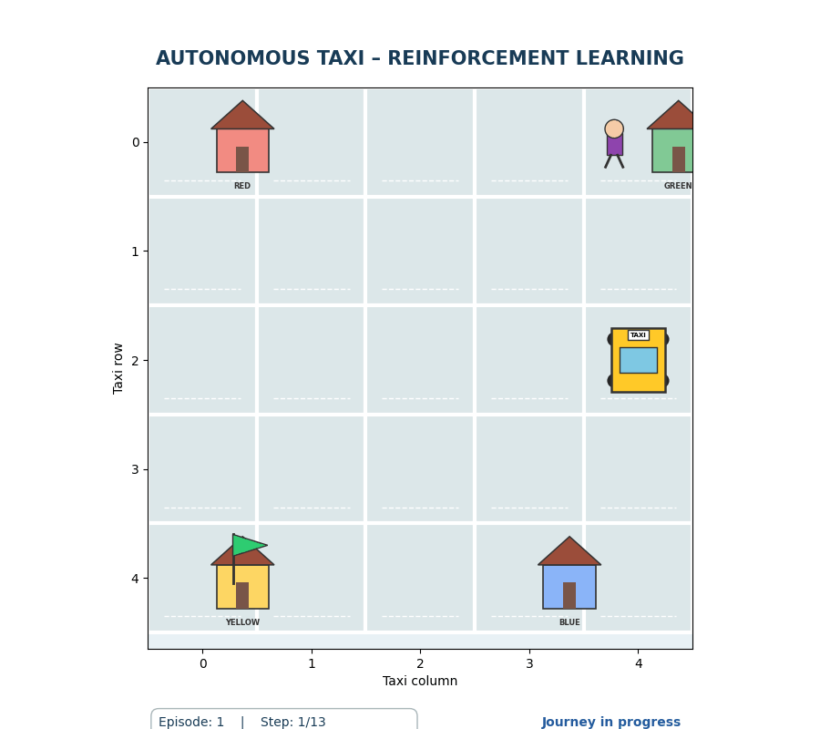

# autonomous-taxi-reinforcement-learning
Autonomous taxi navigation using Q-learning and reinforcement learning

## Project Structure

```text
autonomous-taxi-reinforcement-learning/
│
├── README.md
├── requirements.txt
│
├── notebooks/
│   └── Autonomous_Taxi_Reinforcement_Learning.ipynb
│
├── models/
│   └── taxi_q_table.npy
│
└── results/
    ├── taxi_agent_animation.gif
    ├── hyperparameter_results.xlsx
    │
    └── graphs/
        ├── reward_training.png
        ├── timesteps_training.png
        └── penalties_training.png
```

## Project Overview

This project implements an autonomous taxi agent using
Reinforcement Learning and the Q-learning algorithm.

The agent learns to navigate the Taxi-v3 environment,
pick up passengers and deliver them to their destinations
while maximising rewards and avoiding penalties.

## Technologies Used

- Python
- Gymnasium
- NumPy
- Pandas
- Matplotlib
- Reinforcement Learning
- Q-learning

## Methodology

1. Initialise the Taxi-v3 environment.
2. Create and initialise the Q-table.
3. Train the agent using Q-learning.
4. Implement epsilon decay.
5. Evaluate the baseline and improved models.
6. Conduct hyperparameter experiments.
7. Visualise the agent's behaviour.
8. Save and test the trained Q-table.

## Model Evaluation

| Metric | Baseline | Improved |
|---|---:|---:|
| Average reward | 7.68 | 7.69 |
| Average timesteps | 13.32 | 13.31 |
| Average penalties | 0 | 0 |
| Successful deliveries | 100 | 100 |
| Success rate | 100% | 100% |

Results are based on 100 evaluation episodes per model.

## Hyperparameter Experiments

### Learning Rate
Tested values: 0.1, 0.5, 0.7

### Discount Factor
Tested values: 0.2, 0.6, 0.9

### Epsilon Decay
Tested values: 0.999, 0.9995, 0.9999

## Training Visualisations

## Training Visualisations

### Reward During Training


### Timesteps During Training


### Penalties During Training


## Animated Demonstration:


## Installation

Clone the repository:

```bash
git clone https://github.com/chakri1515/autonomous-taxi-reinforcement-learning.git
```

Install the required libraries:

```bash
pip install -r requirements.txt
```

Open the notebook in Google Colab or Jupyter Notebook.

## Future Improvements

- Experiment with multiple random seeds.
- Implement Deep Q-Networks (DQN).
- Compare different reinforcement learning algorithms.
- Improve the game visualisation.

## Author

CHAKRADAR REDDY KAMIDI (MSc Artificial Intelligence)

## Model

The trained Q-table is available in the `models/`
directory as `taxi_q_table.npy`.

## Notebook

The complete implementation and experiments are
available in the `notebooks/` directory.
