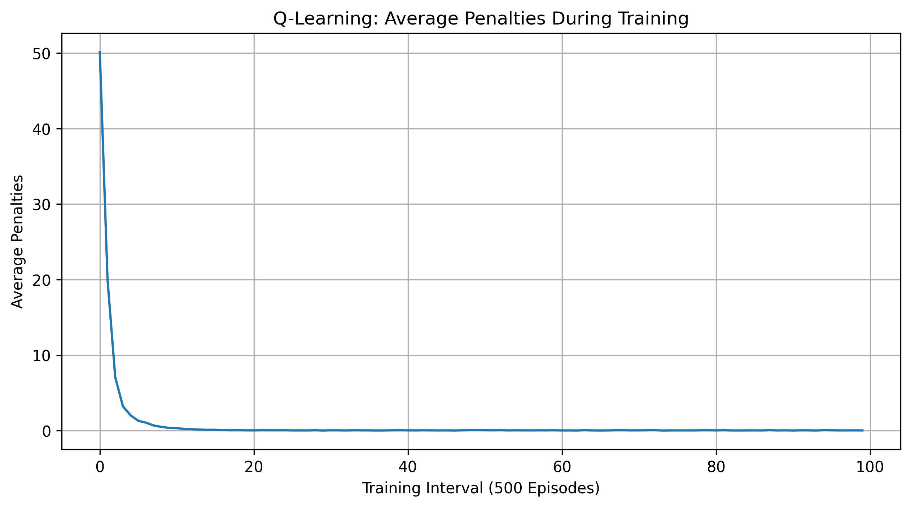

# autonomous-taxi-reinforcement-learning
Autonomous taxi navigation using Q-learning and reinforcement learning

## Project Structure

```text
autonomous-taxi-reinforcement-learning/
│
├── README.md
├── requirements.txt
│
├── notebooks/
│   └── Autonomous_Taxi_Reinforcement_Learning.ipynb
│
├── models/
│   └── taxi_q_table.npy
│
└── results/
    ├── taxi_agent_animation.gif
    ├── hyperparameter_results.xlsx
    │
    └── graphs/
        ├── reward_training.png
        ├── timesteps_training.png
        └── penalties_training.png
```

## Animated Demonstration


## Training Graphs

### Reward


### Timesteps


### Penalties



## Model

The trained Q-table is available in the `models/`
directory as `taxi_q_table.npy`.

## Notebook

The complete implementation and experiments are
available in the `notebooks/` directory.
